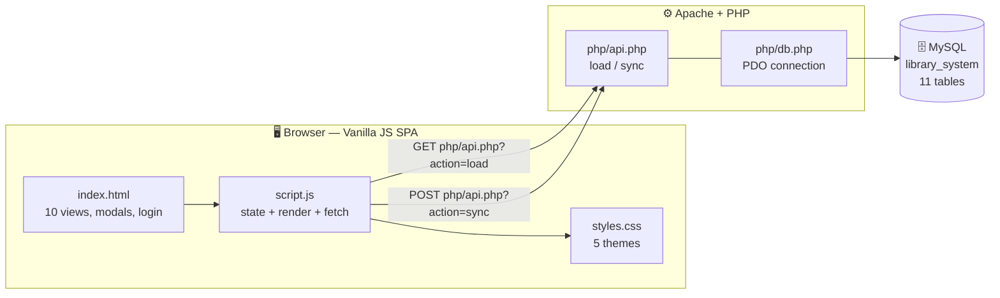

<div align="center">

# 📚 Library Management System

**A full-stack, database-driven library portal built from scratch with vanilla JavaScript, PHP, and MySQL.**

No frameworks. No build step. No npm install. Just a browser, Apache, and a database.


`3 roles` · `10 views` · `11 tables` · `5 themes` · `20 seeded books` · `₱5/day fines` · `0 dependencies`

</div>

---

## 📖 Table of Contents

| | |
|---|---|
| [Overview](#-overview) | [Book Covers](#-book-covers) |
| [What's New](#-whats-new) | [Settings You Can Tune](#-settings-you-can-tune) |
| [How It's Built](#-how-its-built) | [Demo Accounts](#-demo-accounts) |
| [Features](#-features) | [API Reference](#-api-reference) |
| [Roles & Permissions](#-roles--permissions) | [Project Structure](#-project-structure) |
| [Getting Started](#-getting-started) | [Design Notes](#-design-notes--trade-offs) |
| [Database Schema](#-database-schema) | [Themes](#-themes) · [Troubleshooting](#-troubleshooting) |

---

## 🔭 Overview

This is a complete library operation in a single-page app: students browse a real catalog, request books, and get told what happened to their request; a bookkeeper runs the day from an operational dashboard — approving loans, processing returns, collecting late fines, and watching what's overdue; and an administrator manages accounts and runs the support desk. Every change is written back to MySQL through a small PHP API.

It was built as a "no shortcuts" exercise — the UI is hand-written DOM code, the state layer is plain JavaScript objects, and the backend is a single PDO-backed endpoint.

> [!NOTE]
> The app **seeds itself on first load**. If the `users` and `books` tables are empty, the browser inserts the 3 demo accounts and 20 reference books automatically. You only need to create the schema — not the data.

---

## 🆕 What's New

A second pass focused on the things staff and students actually do every day.

| Feature | Where it lives | What it does |
| :--- | :--- | :--- |
| 📊 **Operational dashboard** | Bookkeeper landing page | Overdue counts, pending decisions, shelf occupancy, most-borrowed titles, and an overdue/due-soon list |
| 💰 **Late fines** | Loans, loan details, returns, history, dashboard | ₱5 per overdue day, calculated automatically and surfaced before and after the book comes back |
| ⏰ **Due-date badges** | Active loans, dashboard | *Overdue 3 days · ₱15*, *Due today*, *Due in 2 days* — instead of a raw date |
| 🔒 **Hard borrowing limits** | Request form + approval | 5 books (borrowed **or** requested), 1 copy per title — blocked, not just documented |
| 🚦 **Waitlist auto-promotion** | Returns and cancellations | When a copy frees up, the oldest waitlist request moves into the normal queue |
| 📍 **Waitlist position** | My Requests | Students see *Waitlisted · #2 in line* |
| 🔔 **Result notifications** | Student header banner | "Approved: … due 2026-11-12" / "Rejected: … reason", dismissible, shown for 7 days |
| ⚙️ **Self-service profile** | Click your name in the header | Everyone can change their name and password |
| ⬇️ **History CSV export** | History view | Downloads exactly what's on screen, Excel-safe |
| ♻️ **History for admins** | History view | The Admin now gets the history/archive screen too |
| 📚 **Catalog paging** | Catalog | 12 books at a time with *Show more (N remaining)* |
| ✅ **Available-only filter** | Catalog toolbar | Hide anything currently out on loan |
| 🖼️ **Local book covers** | `covers/` folder | Falls back from the online URL to a bundled image to the emoji icon |
| 🛡️ **Output escaping** | Everywhere text is rendered | Titles, notes and ticket replies are HTML-escaped before rendering |

> [!TIP]
> None of these required a database change — the schema from the earlier version still works as-is. New state is either derived (fines, shelf occupancy), stored in existing JSON columns, or kept in the browser (`localStorage`).

---

## 🏗 How It's Built



| Layer | File | Responsibility |
| :--- | :--- | :--- |
| **Shell** | `index.html` | Login screen, all 10 views, and every modal — one page, no routing library |
| **Presentation** | `styles.css` | Layout, responsive grids, dashboard components, and 5 swappable theme variable sets |
| **Application** | `script.js` | State, role gating, rules and limits, every workflow, `fetch()` calls |
| **Assets** | `covers/` | 20 bundled cover images used when the online URL fails |
| **API** | `php/api.php` | Compatibility load/sync endpoints plus parameterized SQL report queries |
| **Data access** | `php/db.php` | PDO connection with exception-mode errors |

---

## ✨ Features

### 🎓 Role-Based Access Control
Visibility is decided per role, not just per button — a Student never loads the account-management view, and an Admin never loads the catalog, because those flows don't apply to them.

- **Admin** — manage accounts (create, edit, archive, restore), run the support desk, and now oversee borrowing history.
- **Bookkeeper** — lands on the dashboard, owns inventory, approves or rejects requests, sets due dates, processes returns, and judges extension requests.
- **Student** — browses and searches, requests books or joins waitlists, tracks loans and waitlist position, and asks for extensions.

### 📊 Operational Dashboard
The bookkeeper's landing page answers "what needs me right now?" in four panels:

- **Needs your attention** — big-number rows for overdue loans (with the fine accrued so far), requests and extensions waiting on a decision (including how many are waitlisted), and loans due within 3 days. Each row is a button that jumps to the relevant view, and the empty state says *"You're all caught up."*
- **The shelf** — a proportion bar of copies **on the shelf** vs **on loan**, plus catalog size and how many titles are currently out of stock.
- **Most borrowed** — the top 5 titles by all-time loan count (active loans + history).
- **Overdue and due soon** — one chronological list, soonest first, each row carrying a due badge.

### 📖 Catalog & Inventory
- **Real reference books** — 20 seeded titles across **IT, Science, English, and Social Studies** (5 each, published 2020–2025) with cover images, summaries, and links to the source material.
- **Search everything** — one box matches title, category, author, summary, and year.
- **Filters & sorting** — category, publication year (including a 2020–2026 range), an **Available only** switch, and sorting by title, author, or year in either direction.
- **Paged results** — 12 cards at a time with a *Show more (N remaining)* button, so the grid stays fast on a phone.
- **Live availability** — copies on hand are computed from active loans, so a title flips to *out of stock* the moment its last copy is borrowed.
- **Cover fallback chain** — the book's `cover_url` first, then `covers/<title-slug>.<jpg|png|webp|jpeg>`, then `covers/<id>.*`, and finally the emoji icon. See [Book Covers](#-book-covers).
- **Category accents** — each category carries its own color through the card border and badge.

### 🔄 Borrowing Workflows
- **Limits are enforced in code**, not just stated:
  - a student may hold at most **5 books** counted across active loans **and** pending requests;
  - only **1 copy of any title**, checked at both request time and approval time;
  - the request form refuses a duplicate or an over-limit request with a specific message.
- **Approval is validated too** — the bookkeeper can't approve a request if no copy is free, the book has been archived, no due date is set, the student already has that title, or they've hit the loan cap.
- **Waitlists with a place in line** — an out-of-stock title offers *Request* instead of *Borrow*; the request is flagged `WAITLIST` for staff and My Requests shows *Waitlisted · #2 in line*.
- **Waitlist auto-promotion** — processing a return or cancelling a request frees a copy, so the oldest waitlisted request for that title is promoted into the normal queue automatically (first come, first served).
- **Rejections are recorded** — a declined request is saved with its reason and appears in that student's history.
- **Extensions** — students submit a reason; on approval the old and new due dates are both appended to the loan's audit trail. A returned loan can't be extended, and approving an extension clears the pending request.
- **Returns** — processing a return moves the loan into history, promptly frees the copy, promotes waitlists, and flags any fine.

### 💰 Late Fines & Due Dates
- **₱5 per overdue day**, computed as `max(0, returned − due) × 5` on date-only values, so it never drifts with timezones or times of day.
- **While still out:** overdue loans carry a red badge — *Overdue 3 days · ₱15* — and the amount keeps growing because it's derived from today's date, not stored at checkout.
- **On return:** if the book came back late, the bookkeeper gets a "Collect a fine of ₱X" dialog with the exact day count.
- **In history:** every returned loan shows its final fine, and the dashboard totals everything currently outstanding.
- Fines are informational — nothing blocks a student, and no payment is recorded. See [Design Notes](#-design-notes--trade-offs).

### 🔔 Student Notifications
A banner above the content tells students what happened to their requests in the last 7 days — approved (with the due date) or rejected (with the reason). Dismissing it writes the seen IDs to that student's `localStorage`, so it stays gone for that browser without needing a notifications table. Each view switch re-checks for anything new.

### ⚙️ Self-Service Profile
Clicking your name in the header opens **My Profile**: change your display name, and optionally change your password by confirming the current one. Username is shown but locked (it's the login key), and students also see their student ID and section — the two fields they need before they can borrow anything.

### 🕘 History & CSV Export
- **One unified list** merges returned loans (with fine) and rejected requests (with reason), newest first.
- **Role-aware**: students see only their own records and never the archive toggle; staff see everything with View / Archive / Unarchive actions; the Admin now has this screen as well.
- **Export CSV** downloads whatever the table is currently showing — the same filtered and sorted list, including fines — with a UTF-8 BOM so Excel opens it cleanly, and cells starting with `= + - @` are prefixed so a book title can't turn into a spreadsheet formula.

### 🗄️ Archiving Instead of Deleting
Users, books, history records, and rejections all carry an `is_archived` flag, and the **Accounts**, **Manage Books**, and **History** views each have a *Show Archived / Show Active* toggle. Nothing is ever destroyed by accident, and anything archived can be restored.

### 🎫 Support Tickets
- Any signed-in student can open a support ticket; the Admin sees an **Open / Resolved** queue with numbered positions for open chats.
- Replies are threaded and stored per ticket; the Admin can close and reopen a conversation.
- **Locked-out users are handled too** — the login screen offers a guest account-recovery form and a ticket tracker keyed to the browser via `localStorage`, so someone who can't sign in can still reach a human.

### 🎨 UI/UX
- **5 themes**, switchable live and remembered per browser.
- Fully responsive: dashboard panels stack, toolbars wrap, tables scroll, and forms reflow to one column on mobile.
- Philippine-friendly formatting throughout — dates as `en-PH`, currency as `₱`.
- Real form elements, `hidden` rather than `display:none` for views, focus styles on the dashboard's clickable rows, and a keyboard-submittable login.

---

## 🔑 Roles & Permissions

| Capability | 🎓 Student | 📚 Bookkeeper | 🛡️ Admin |
| :--- | :---: | :---: | :---: |
| Operational dashboard | — | ✅ | — |
| Browse & search the catalog | ✅ | ✅ | — |
| Request a book / join a waitlist | ✅ | — | — |
| See own requests, queue position, notifications | ✅ | — | — |
| Approve / reject borrow requests | — | ✅ | — |
| Set due dates, process returns, collect fines | — | ✅ | — |
| Request a loan extension | ✅ | — | — |
| Review extension requests | — | ✅ | — |
| Add / edit / archive books | — | ✅ | — |
| Add / edit / archive accounts | — | — | ✅ |
| View borrowing history | own | all | all |
| Archive / restore history records | — | ✅ | ✅ |
| Export history to CSV | own | all | all |
| Open a support ticket | ✅ | — | — |
| Reply to, close & reopen tickets | — | — | ✅ |
| Edit own name & password | ✅ | ✅ | ✅ |

> [!TIP]
> Not sure where to start? Sign in as **student** to request a book, then as **keeper** to approve it from the dashboard, then as **admin** to see the account and ticket side of the app.

---

## 🚀 Getting Started

### Prerequisites

| Requirement | Why |
| :--- | :--- |
| [XAMPP](https://www.apachefriends.org/index.html) | Apache + PHP. (Any Apache/PHP 8 stack works.) |
| MySQL 8 **or** MariaDB | The database. Either the standalone MySQL Server or the one bundled with XAMPP. |
| [MySQL Workbench](https://dev.mysql.com/downloads/workbench/) *(optional)* | A GUI for running the schema — any MySQL client is fine. |

> [!IMPORTANT]
> **XAMPP and MySQL Workbench are two different things — don't mix them up.**
>
> - **XAMPP** ships Apache (the web server that runs PHP) *and* a copy of **MariaDB**, which it calls "MySQL" in its control panel.
> - **MySQL Workbench** is only a *client* — a GUI for talking to a server. If you installed the standalone **MySQL Server** with it (the standard installer does this), that server runs as a **Windows service** in the background, usually on port **3306**.
>
> Both servers want port **3306**, so run **one or the other** — never both. This guide follows **Path B**, which is the setup `php/db.php` ships with; if you prefer Path A, just simplify the credentials in Step 4.

**Pick a path:**

| Path | Start in XAMPP | Database server | `php/db.php` credentials |
| :--- | :--- | :--- | :--- |
| **A · all-in-one** | Apache **+ MySQL** | XAMPP's bundled MariaDB | `root` / *(empty)* |
| **B · standalone** *(this guide)* | **Apache only** | The MySQL Server installed with Workbench | `library_admin` / your password |

---

### Step 1 — Put the project in `htdocs`

Clone or download this repository, then move the folder into XAMPP's web root:

```text
C:\xampp\htdocs\library      (or D:\Xampp\htdocs\library)
```

You should end up with `...\htdocs\library\index.html` as a direct child, with the `covers/` folder beside it.

### Step 2 — Start the servers

1. Open the **XAMPP Control Panel** and start **Apache**.
2. Confirm your **MySQL Server** is running: open **Services** (`Win + R` → `services.msc`) and look for `MySQL80`, *or* check the Workbench home screen shows a live local instance.
3. Verify port **3306** is listening:

```powershell
netstat -ano | findstr :3306
```

> [!WARNING]
> If you see two servers fighting over 3306, XAMPP's MySQL will fail to start with an "unexpected shutdown" error. Leave XAMPP's MySQL **stopped** when using the standalone server (or vice versa) — never both.

### Step 3 — Create the database & tables

Open **MySQL Workbench**, connect to your local instance, open a new query tab, and run the script from the [Database Schema](#-database-schema) section below.

That's all the SQL you need — **the app seeds its own data.** On first load the JavaScript detects empty `users` and `books` tables and inserts the 3 demo accounts plus 20 books.

### Step 4 — Configure the connection

Open `php/db.php` and match it to your setup:

```php
<?php
$host = '127.0.0.1';
$db   = 'library_system';
$user = 'library_admin';
$pass = 'YOUR_MYSQL_PASSWORD';

try {
    $pdo = new PDO("mysql:host=$host;dbname=$db;charset=utf8mb4", $user, $pass);
    $pdo->setAttribute(PDO::ATTR_ERRMODE, PDO::ERRMODE_EXCEPTION);
} catch (PDOException $e) {
    die("Database connection failed: " . $e->getMessage());
}
```

Two supported options:

**Option 1 · Dedicated user (recommended).** Run this once in Workbench, then leave `php/db.php` as-is and set the password:

```sql
CREATE USER 'library_admin'@'localhost'
  IDENTIFIED BY 'YOUR_MYSQL_PASSWORD';

GRANT ALL PRIVILEGES
  ON library_system.*
  TO 'library_admin'@'localhost';

FLUSH PRIVILEGES;
```

**Option 2 · Use `root`.** Change the two credential lines in `php/db.php`:

```php
$user = 'root';
$pass = 'your_root_password';
```

XAMPP's default root password is **empty** (`''`); standalone MySQL Server requires **the password you set during installation**.

> [!NOTE]
> `127.0.0.1` is used instead of `localhost` on purpose. On Windows, `localhost` can make PDO attempt a named pipe/socket and fail; `127.0.0.1` forces a TCP connection to 3306.

### Step 5 — Run it

Open **<http://localhost/library/index.html>** and sign in with one of the [demo accounts](#-demo-accounts).

**Expected first-load sequence**

1. `php/api.php?action=load` returns empty `users` / `books`.
2. The app swaps in its seed data and immediately calls `sync`.
3. You land on the login screen; the roles now exist in MySQL.

If the page loads but the catalog is empty, open DevTools → **Network** and check the `php/api.php` response — see [Troubleshooting](#-troubleshooting).

---

## 💾 Database Schema

The normalized schema in `sql/database.sql` uses InnoDB foreign keys, required fields, unique constraints, indexes, and separate child tables for loan extensions, ticket replies, and administrator activity logs. If the existing database is already running, execute `sql/admin_logs_upgrade.sql` once in Workbench before using the Admin Logs view. The API keeps the browser's existing JSON shape while resolving names through joins.

<details open>
<summary><b>📋 Create script — run this once in MySQL Workbench</b></summary>

<br>

```sql
CREATE DATABASE IF NOT EXISTS library_system
  CHARACTER SET utf8mb4 COLLATE utf8mb4_unicode_ci;

USE library_system;

-- 1. Accounts (all three roles live here)
CREATE TABLE users (
    id          BIGINT AUTO_INCREMENT PRIMARY KEY,
    name        VARCHAR(100),
    username    VARCHAR(50) UNIQUE,
    password    VARCHAR(255),
    role        VARCHAR(50),          -- Admin | Bookkeeper | Student
    student_num VARCHAR(50),
    section     VARCHAR(50),
    is_archived TINYINT(1) DEFAULT 0
);

-- 2. Catalog
CREATE TABLE books (
    id            BIGINT AUTO_INCREMENT PRIMARY KEY,
    title         VARCHAR(255),
    cat           VARCHAR(50),        -- IT | Science | English | Social Studies
    copies        INT,
    author        VARCHAR(100),
    published     VARCHAR(10),
    icon          VARCHAR(10),
    summary       TEXT,
    cover_url     VARCHAR(500),
    reference_url VARCHAR(500),
    is_archived   TINYINT(1) DEFAULT 0
);

-- 3. Pending borrow requests (including waitlists)
CREATE TABLE requests (
    id            BIGINT AUTO_INCREMENT PRIMARY KEY,
    bookId        BIGINT,
    studentId     BIGINT,
    studentName   VARCHAR(100),
    reqStudentId  VARCHAR(50),
    reqSection    VARCHAR(50),
    reqContact    VARCHAR(100),
    notes         TEXT,
    isWaitlist    BOOLEAN,
    dateRequested VARCHAR(50)
);

-- 4. Active loans
CREATE TABLE loans (
    id         BIGINT AUTO_INCREMENT PRIMARY KEY,
    bookId     BIGINT,
    borrowerId BIGINT,
    borrower   VARCHAR(100),
    due        VARCHAR(50),
    notes      TEXT,
    extensions LONGTEXT               -- JSON array of { oldDue, newDue, reason }
);

-- 5. Returned loans
CREATE TABLE history (
    id          BIGINT AUTO_INCREMENT PRIMARY KEY,
    bookId      BIGINT,
    borrowerId  BIGINT,
    borrower    VARCHAR(100),
    due         VARCHAR(50),
    returnedAt  VARCHAR(50),
    notes       TEXT,
    extensions  LONGTEXT,
    is_archived TINYINT(1) DEFAULT 0
);

-- 6. Rejected requests (audit trail with reason)
CREATE TABLE rejections (
    id            BIGINT AUTO_INCREMENT PRIMARY KEY,
    bookId        BIGINT,
    studentId     BIGINT,
    studentName   VARCHAR(100),
    reqStudentId  VARCHAR(50),
    reqSection    VARCHAR(50),
    dateRequested VARCHAR(50),
    reason        TEXT,
    dateProcessed VARCHAR(50),
    is_archived   TINYINT(1) DEFAULT 0
);

-- 7. Extension requests awaiting review
CREATE TABLE extension_requests (
    id          BIGINT AUTO_INCREMENT PRIMARY KEY,
    loanId      BIGINT,
    bookName    VARCHAR(255),
    studentName VARCHAR(100),
    reason      TEXT
);

-- 8. Support tickets (desc is a reserved word — hence the backticks)
CREATE TABLE tickets (
    id       BIGINT AUTO_INCREMENT PRIMARY KEY,
    userId   VARCHAR(50),             -- numeric id, or "guest"
    userName VARCHAR(100),
    subject  VARCHAR(255),
    `desc`   TEXT,
    date     VARCHAR(50),
    time     VARCHAR(50),
    status   VARCHAR(50),             -- Open | Resolved
    replies  LONGTEXT                 -- JSON array of { sender, text, date }
);
```

</details>

### Table reference

| Table | Holds | Notable columns |
| :--- | :--- | :--- |
| `users` | Every account, all roles | `role` drives the entire UI; `is_archived` |
| `books` | Catalog + inventory | `copies` (total stock), `cover_url`, `reference_url`, `is_archived` |
| `requests` | Pending borrow/waitlist asks | `isWaitlist`, `reqStudentId`, `reqContact` |
| `loans` | Currently borrowed books | `due` (drives badges and fines), `extensions` (JSON audit trail) |
| `history` | Completed loans | `returnedAt` (fine = `returnedAt − due`), `is_archived` |
| `rejections` | Declined requests | `reason`, `dateProcessed`, `is_archived` |
| `extension_requests` | Pending due-date extensions | `loanId` links back to `loans` |
| `tickets` | Support conversations | `status`, `replies` (JSON thread) |

> [!NOTE]
> Dates are stored as `VARCHAR` (`YYYY-MM-DD` strings) rather than `DATE`/`DATETIME`. This keeps the JSON round-trip between the browser and PHP lossless and makes the fine arithmetic a simple subtraction of day-only values. See [Design Notes](#-design-notes--trade-offs) for the trade-off.

---

## 🖼 Book Covers

Each card resolves its image in this order, and silently steps to the next one on error:

1. the book's `cover_url` (any absolute or relative URL);
2. `covers/<title-slug>.<ext>` — lowercase, `&` → `and`, everything else non-alphanumeric → `-`;
3. `covers/<book-id>.<ext>`;
4. the book's emoji `icon` (e.g. 💻) if nothing loads.

`<ext>` is tried as `jpg`, `png`, `webp`, then `jpeg`.

To add a cover, drop a file in `covers/` using either naming scheme — no code change needed:

```text
covers/Introduction-to-Computer-Science.png   ← slug from the title
covers/9.webp                                 ← or just the book id
```

> [!TIP]
> Prefer the title slug: ids stay stable, but a slug survives re-seeding the database and is much easier to match up with a real book.

---

## ⚙️ Settings You Can Tune

The three policy numbers live in one block near the top of `script.js`:

```js
const MAX_LOANS = 5;        // max books a student can have borrowed + requested at once
const FINE_PER_DAY = 5;     // late fine (pesos) per overdue day
const CATALOG_PAGE = 12;    // books shown before "Show more"
```

| Constant | Default | Effect |
| :--- | :--- | :--- |
| `MAX_LOANS` | `5` | Enforced in the request form **and** at approval; counts loans + pending requests |
| `FINE_PER_DAY` | `5` | Badge text, return dialog, history column and dashboard totals all follow it |
| `CATALOG_PAGE` | `12` | Cards per page before *Show more* |

The 14-day loan period and 7-day extension default are set in `addDays(14)` / `addDays(7)` inside the approval and extension modals, and the "due soon" window is the `d <= 3` check in `dueBadge()`.

---

## 🔐 Demo Accounts

| Role | Username | Password | Lands on |
| :--- | :--- | :--- | :--- |
| 🛡️ **Admin** | `admin` | `admin123` | Accounts |
| 📚 **Bookkeeper** | `keeper` | `keeper123` | Dashboard |
| 🎓 **Student** | `student` | `student123` | Catalog |

> [!CAUTION]
> These are **plain-text demo credentials** committed for convenience. Before deploying anywhere real, hash passwords with `password_hash()` and verify with `password_verify()`, and remove the demo block from the login screen. The in-app profile editor compares passwords in plain text too.

---

## 🔌 API Reference

One file exposes JSON load/sync compatibility actions plus parameterized report queries. The normalized MySQL schema is in `database.sql`.

For a live demonstration, run `presentation_data.sql` after the seeded users and books have been loaded. It is additive-only: it does not drop, delete, or insert books. It adds demo students, exhausts seeded books through active loans, creates waitlisted and pending requests, approved/extended/returned/rejected records, and admin/guest tickets with replies.

### `GET php/api.php?action=load`

Returns every row of every table in one payload, normalized for JavaScript:

```json
{
  "users":  [{ "id": 1, "studentNum": "2024-00123", "is_archived": false }],
  "books":  [{ "id": 1, "title": "…", "copies": 5 }],
  "requests": [], "loans": [], "history": [],
  "rejections": [], "extension_requests": [], "tickets": []
}
```

Normalizations applied server-side:

| Column | Becomes |
| :--- | :--- |
| `id`, `bookId`, `studentId`, `borrowerId`, `loanId` | `int` |
| `student_num` | `studentNum` |
| `extensions`, `replies` | decoded JSON (arrays), not strings |
| `isWaitlist`, `is_archived` | real booleans |

On load the client also drops extension requests whose loan no longer exists, so a stale record can't block anything.

### `POST php/api.php?action=sync`

Accepts the **entire application state**:

```json
{
  "users": [], "books": [], "loans": [], "history": [],
  "requests": [], "rejections": [], "extensionRequests": [], "tickets": []
}
```

Runs inside a single transaction and writes the normalized tables with prepared `INSERT`, `UPDATE`-on-duplicate, and `DELETE` statements. Names are resolved through SQL joins, while extensions and ticket replies are stored in their own related tables.

> [!TIP]
> The client appends a cache-buster (`&t=` + timestamp) and sends `no-store`, so stale GETs can't resurrect old data after a sync.

### `GET php/api.php?action=query&type=...`

Parameterized DBMS demonstration queries are available for `catalog_search`, `category_summary`, `active_loans`, and `overdue_summary`. They demonstrate `WHERE`, `LIKE`, `LIMIT`, aliases, aggregate functions, `GROUP BY`, `HAVING`, `ORDER BY`, `INNER JOIN`, and `COALESCE`.

---

## 📂 Project Structure

```text
LMS/
├── sql/
│   ├── database.sql    · normalized InnoDB schema, foreign keys, checks, and indexes
│   ├── presentation_data.sql · optional demo records
│   └── admin_logs_upgrade.sql · adds admin activity logs to an existing database
├── index.html    ~870 lines  · login, 10 views, dashboard, all modals
├── styles.css    ~375 lines  · 5 theme variable sets, grids, dashboard UI
├── script.js   ~2,000 lines  · state, rules, fines, every workflow
├── php/
│   ├── api.php    · load + sync endpoints (PDO, transactions)
│   └── db.php     · PDO connection (edit credentials here)
├── covers/        20 images   · bundled book covers (optional)
└── README.md
```

<details>
<summary><b>What lives where inside the big files</b></summary>

<br>

**`index.html`** — one `<section>` per view, all hidden by default and toggled by `switchView()`:

| View | Section id | Visible to |
| :--- | :--- | :--- |
| Guidelines | `view-info` | everyone |
| Dashboard | `view-dashboard` | Bookkeeper |
| Catalog | `view-catalog` | Student, Bookkeeper |
| My Requests | `view-my-requests` | Student |
| Borrow Requests | `view-requests` | Bookkeeper |
| Active Loans | `view-loans` | Student, Bookkeeper |
| History | `view-history` | everyone |
| Manage Books | `view-books` | Bookkeeper |
| Accounts | `view-users` | Admin |
| Support Tickets | `view-tickets` | Student, Admin |

**`script.js`** — in rough execution order:

| Region | Purpose |
| :--- | :--- |
| `MAX_LOANS` / `FINE_PER_DAY` / `CATALOG_PAGE` | The policy numbers in one place |
| Helpers (`esc`, `today`, `dayDiff`, `fineFor`, `money`, `dueBadge`) | Escaping, date math, fine calculation, ₱ formatting, status badges |
| `promoteWaitlist()` | Moves oldest waitlist requests up when copies free |
| `seedUsers` / `seedBooks` | First-run data, used only when the DB is empty |
| Theme block | Reads `localStorage.themeName`, applies `data-theme`, remembers choice |
| `save()` | Serializes state → `POST php/api.php?action=sync`, surfaces PHP errors as alerts |
| `showApp()` / `switchView()` | Role gating, default view per role, rendering |
| `renderCatalog()` … `renderTickets()` | One render function per view, rebuilding tables/cards from state |
| `renderDashboard()` | The four dashboard panels |
| `renderNotifications()` | Student result banner, dismissed via `localStorage` |
| `historyItems()` / `exportHistoryCsv()` | Shared list behind both the History table and the CSV download |
| `openProfile()` / `saveProfile()` | Self-service name and password editing |
| Modal + workflow handlers | `approveRequest`, `returnBook`, `approveExtension`, `archiveUser`, … |
| `initApp()` | Loads from the API, seeds if empty, validates and restores the saved session |

</details>

---

## 🧠 Design Notes & Trade-offs

Honest notes on the architecture — plus where it would need work before real use.

**Full-state sync instead of REST resources.** Rather than building `POST /books`, `PUT /users`, and so on, every change ships the whole application state to `php/api.php`, which deletes every row and re-inserts the payload inside a transaction. This kept the backend compact and made the frontend trivially consistent, since there is exactly one write path. The cost is real: writes are O(all rows), last write wins, and two simultaneous users can clobber each other. A production version would move to per-entity endpoints with `PATCH` semantics.

**Rules are checked twice, in the browser.** The 5-book and 1-copy limits are now genuinely blocked — in the request form *and* again at approval, alongside stock, archived-book, and missing-due-date checks. But both checks live in `script.js`, so they stop mistakes, not a determined user with DevTools. Server-side validation is the next step.

**Fines are calculated, never stored.** `fineFor(due, returnedAt)` derives the amount from two `YYYY-MM-DD` strings, which means an overdue loan's fine grows on its own and history can't disagree with itself. The flip side: changing `FINE_PER_DAY` silently rewrites past fines, and nothing records payment. If fines ever need to be billed, they need their own columns (`fine`, `paid`) and an issuance step at return time.

**Dates as strings, arithmetic in the browser.** `VARCHAR(50)` dates keep the JSON round-trip lossless and `dayDiff()` trivial, but `ORDER BY due` is only correct because the format is ISO, and every date comparison happens on the client. Real `DATE` columns plus database-side overdue queries would be the mature version.

**Notifications without a notifications table.** "Your request was approved" is reconstructed from existing `loans` / `rejections` rows, using the loan's timestamp id to tell what's recent, and dismissed state lives in `localStorage`. Zero schema changes, at the cost of the banner being per-browser rather than per-account (and of "recent" being a 7-day guess).

**Archive, don't delete.** Every destructive-looking button in the UI actually flips `is_archived`, and each management view can toggle between active and archived records. Availability counts, catalog listings, and history all filter on the flag, so archived books still resolve correctly in historical records instead of showing as "Unknown".

**Client-assigned IDs.** New rows get `Date.now()` as their primary key, which keeps inserts self-contained without a round-trip for `LAST_INSERT_ID()` — and doubles as the "when was this approved" signal the notification banner reads.

**Everything in one page.** `index.html` and `script.js` are large by modern standards on purpose: there is no bundler, no module resolution, and therefore no build step — you edit a file, refresh the browser, done. Splitting into ES modules would be the first refactor.

**Two deliberately narrow roles.** Support tickets are reachable by **students** (their own conversations) and **admins** (the full queue) — the tab is hidden for bookkeepers, so the feature is effectively student ↔ admin. The dashboard is bookkeeper-only for the same reason: it's a work queue, not a report. Both are one-line changes in `showApp()` if you want a different split.

---

## 🎨 Themes

Switchable from the header; the choice persists in `localStorage` under `themeName`.

| Theme | Mood | Canvas | `--bg` | `--primary` |
| :--- | :--- | :---: | :--- | :--- |
| 🌊 **Midnight Ocean** *(default)* | Deep navy & teal glow |  | `#0d1b2a` | `#14b8a6` |
| 🕯️ **Reading Room Dark** | Charcoal & banker's lamp |  | `#181817` | `#fbbf24` |
| 📜 **Parchment Archive** | Sepia ink on cotton rag |  | `#f2ebd9` | `#b45309` |
| 🤍 **Warm Alabaster** | Warm alabaster & forest |  | `#f9f6f0` | `#059669` |
| 🌿 **Sage Morning** | Soft mint & green ink |  | `#e6efe6` | `#15803d` |

Each theme is a single block of CSS custom properties (`--bg`, `--surface`, `--text`, `--primary`, …). Dashboard panels, badges, and notification banners all read those variables, so a new theme automatically covers every new component.

---

## 🧯 Troubleshooting

| Symptom | Likely cause | Fix |
| :--- | :--- | :--- |
| `Database connection failed: SQLSTATE[HY000] [1045]` | Wrong user/password | Update `php/db.php`; XAMPP root is blank, standalone MySQL root is not |
| `… [2002] No connection could be made` | MySQL service isn't running | Start `MySQL80` in Services, or XAMPP's MySQL (not both) |
| Page loads, catalog empty, console shows JSON parse error | `php/api.php` returned an HTML error | Open `php/api.php?action=load` directly — the HTML will name the real PHP error |
| `Table 'library_system.users' doesn't exist` | Schema never ran | Re-run the Step 3 script in the correct database |
| Alert: **"Failed to connect to php/api.php. Is XAMPP running?"** | Apache stopped, or wrong folder | Start Apache; confirm you're at `localhost/library/…`, not `file://` |
| `netstat` shows two listeners on 3306 | XAMPP MySQL + standalone MySQL both running | Stop one of them |
| Changes vanish after a refresh | `sync` failed silently | Check the Network tab for the `sync` response body |
| Book covers show an emoji instead of a picture | No online URL and no matching file | Name the file after the title slug or the book id, both in `covers/` |
| Covers show on one machine, not another | Filenames are case-sensitive on some hosts | Match the slug's lowercase-hyphen form exactly |
| Fines look one day off | "Today" comes from the browser's local date | Check the PC's date — `today()` uses `en-CA` local time, not UTC |
| Dashboard says you're all caught up with data visible | Dashboard is bookkeeper-only | Sign in as `keeper` |
| Notification banner reappears per device | Dismissal is stored in `localStorage` | Expected — it's per-browser, not per-account |

---

## 🗺️ Roadmap

- [ ] Hash passwords (`password_hash` / `password_verify`) and remove plain-text demo credentials
- [ ] Server-side validation of every rule (limits, stock, fines)
- [ ] Replace full-state sync with per-entity endpoints
- [ ] Store fines as columns so they can be billed, waived, and audited
- [ ] Real `DATE` columns + database-side overdue queries
- [ ] Server-backed notifications instead of a 7-day `localStorage` banner
- [ ] Pagination at the API level (catalog paging is client-side today)
- [ ] Split `script.js` into ES modules
- [ ] Automated tests (PHPUnit for the API, Playwright for the flows)

---

## 📄 License

Released under the [MIT License](https://opensource.org/licenses/MIT) — free to use, learn from, and build on.

<div align="center">

**Built from scratch with vanilla JS, PHP, and MySQL.**
If this helped you, a ⭐ on the repo goes a long way.

</div>
