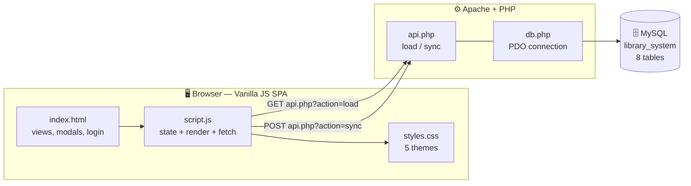

<div align="center">

# 📚 Library Management System

**A full-stack, database-driven library portal built from scratch with vanilla JavaScript, PHP, and MySQL.**

No frameworks. No build step. No npm install. Just a browser, Apache, and a database.


`3 roles` · `8 tables` · `5 themes` · `20 seeded books` · `0 dependencies`

</div>

---

## 📖 Table of Contents

| | |
|---|---|
| [Overview](#-overview) | [How It's Built](#-how-its-built) |
| [Features](#-features) | [Getting Started](#-getting-started) |
| [Roles & Permissions](#-roles--permissions) | [Database Schema](#-database-schema) |
| [Demo Accounts](#-demo-accounts) | [API Reference](#-api-reference) |
| [Project Structure](#-project-structure) | [Design Notes](#-design-notes--trade-offs) |
| [Themes](#-themes) | [Troubleshooting](#-troubleshooting) |

---

## 🔭 Overview

This is a complete library operation in a single-page app: students browse a real catalog and request books, a bookkeeper approves loans and processes returns, and an administrator manages accounts and support tickets. Every change is written back to MySQL through a small PHP API.

It was built as a "no shortcuts" exercise — the UI is hand-written DOM code, the state layer is plain JavaScript objects, and the backend is a single PDO-backed endpoint.

> [!NOTE]
> The app **seeds itself on first load**. If the `users` and `books` tables are empty, the browser inserts the 3 demo accounts and 20 reference books automatically. You only need to create the schema — not the data.

---

## 🏗 How It's Built



| Layer | File | Responsibility |
| :--- | :--- | :--- |
| **Shell** | `index.html` | Login screen, all views, and every modal — one page, no routing library |
| **Presentation** | `styles.css` | Layout, responsive grid, and 5 swappable theme variable sets |
| **Application** | `script.js` | State, role gating, every workflow, `fetch()` calls |
| **API** | `api.php` | Two actions: `load` (read everything) and `sync` (write everything) |
| **Data access** | `db.php` | PDO connection with exception-mode errors |

---

## ✨ Features

### 🎓 Role-Based Access Control
Visibility is decided per role, not just per button — a Student never loads the account-management view, and an Admin never loads the catalog, because those flows don't apply to them.

- **Admin** — manage accounts (create, edit, archive, restore) and run the support desk: read tickets, reply, close, and reopen.
- **Bookkeeper** — own the inventory, approve or reject borrow requests, set due dates, process returns, and judge extension requests.
- **Student** — browse and search, request books or join waitlists, track loans, and ask for extensions.

### 📖 Catalog & Inventory
- **Real reference books** — 20 seeded titles across **IT, Science, English, and Social Studies** (5 each, published 2020–2025) with cover images, summaries, and links to the source material.
- **Search everything** — one box matches title, category, author, summary, and year.
- **Filters & sorting** — filter by category or by year (including a 2020–2026 range); sort by title, author, or publication date in either direction.
- **Live availability** — copies on hand are computed from active loans, so a title flips to *out of stock* the moment its last copy is borrowed.
- **Category accents** — each category carries its own color through the card border and badge.

### 🔄 Borrowing Workflows
- **A stated borrowing policy** — max **5 active loans**, **1 copy per title**, **14-day** standard period. The rule is surfaced to both students and bookkeepers inside the app; the bookkeeper applies it when approving. (It is *not* hard-blocked in code — see [Design Notes](#-design-notes--trade-offs).)
- **Waitlist** — an out-of-stock title swaps its request button for *Join waitlist*; the request is flagged `WAITLIST` in the bookkeeper's queue.
- **Rejections are recorded** — a declined request is saved with its reason and appears in that student's history, instead of vanishing with the modal.
- **Extensions** — students submit a reason; on approval the old and new due dates are both appended to the loan's audit trail instead of overwriting history.
- **Returns** — processing a return moves the loan into history and immediately frees the copy.

### 🗄️ Archiving Instead of Deleting
Users, books, history records, and rejections all carry an `is_archived` flag, and the **Accounts**, **Manage Books**, and **History** views each have a *Show Archived / Show Active* toggle. Nothing is ever destroyed by accident, and anything archived can be restored.

### 🎫 Support Tickets
- Any signed-in student can open a support ticket; the Admin sees an **Open / Resolved** queue.
- Replies are threaded and stored per ticket; the Admin can close and reopen a conversation.
- **Locked-out users are handled too** — the login screen offers a guest account-recovery form and a ticket tracker (keyed to the browser via `localStorage`), so someone who can't sign in can still reach a human.

### 🎨 UI/UX
- **5 themes**, switchable live and remembered per browser.
- Fully responsive: the header collapses, tables scroll, and forms reflow to one column on mobile.
- Accessible-ish defaults throughout: `hidden` rather than `display:none` for views, real form elements, and keyboard-submittable login.

---

## 🔑 Roles & Permissions

| Capability | 🎓 Student | 📚 Bookkeeper | 🛡️ Admin |
| :--- | :---: | :---: | :---: |
| Browse & search the catalog | ✅ | ✅ | — |
| Request a book / join a waitlist | ✅ | — | — |
| Track own requests & due dates | ✅ | — | — |
| Approve / reject borrow requests | — | ✅ | — |
| Set due dates & process returns | — | ✅ | — |
| Request a loan extension | ✅ | — | — |
| Review extension requests | — | ✅ | — |
| Add / edit / archive books | — | ✅ | — |
| Add / edit / archive accounts | — | — | ✅ |
| View borrowing history | own | all | — |
| Archive / restore history | — | ✅ | —\* |
| Open a support ticket | ✅ | — | — |
| Reply to & resolve tickets | — | — | ✅ |

> [!TIP]
> Not sure where to start? Sign in as **student** to see the catalog, then as **keeper** to approve that student's request, then as **admin** to see the account and ticket side of the app.
>
> \* The archive/restore logic for history records is fully implemented, but the **History** tab is hidden for the Admin role in `showApp()`, so in practice only the Bookkeeper reaches it — see [Design Notes](#-design-notes--trade-offs).

---

## 🚀 Getting Started

### Prerequisites

| Requirement | Why |
| :--- | :--- |
| [XAMPP](https://www.apachefriends.org/index.html) | Apache + PHP. (Any Apache/PHP 8 stack works.) |
| MySQL 8 **or** MariaDB | The database. Either the standalone MySQL Server or the one bundled with XAMPP. |
| [MySQL Workbench](https://dev.mysql.com/downloads/workbench/) *(optional)* | A GUI for running the schema — any MySQL client is fine. |

> [!IMPORTANT]
> **XAMPP and MySQL Workbench are two different things — don't mix them up.**
>
> - **XAMPP** ships Apache (the web server that runs PHP) *and* a copy of **MariaDB**, which it calls "MySQL" in its control panel.
> - **MySQL Workbench** is only a *client* — a GUI for talking to a server. If you installed the standalone **MySQL Server** with it (the standard installer does this), that server runs as a **Windows service** in the background, usually on port **3306**.
>
> Both servers want port **3306**, so run **one or the other** — never both. This guide follows **Path B**, which is the setup `db.php` ships with; if you prefer Path A, just simplify the credentials in Step 4.

**Pick a path:**

| Path | Start in XAMPP | Database server | `db.php` credentials |
| :--- | :--- | :--- | :--- |
| **A · all-in-one** | Apache **+ MySQL** | XAMPP's bundled MariaDB | `root` / *(empty)* |
| **B · standalone** *(this guide)* | **Apache only** | The MySQL Server installed with Workbench | `library_admin` / your password |


---

### Step 1 — Put the project in `htdocs`

Clone or download this repository, then move the folder into XAMPP's web root:

```text
C:\xampp\htdocs\library      (or D:\Xampp\htdocs\library)
```

You should end up with `...\htdocs\library\index.html` as a direct child.

### Step 2 — Start the servers

1. Open the **XAMPP Control Panel** and start **Apache**.
2. Confirm your **MySQL Server** is running: open **Services** (`Win + R` → `services.msc`) and look for `MySQL80`, *or* check the Workbench home screen shows a live local instance.
3. Verify port **3306** is listening:

```powershell
netstat -ano | findstr :3306
```

> [!WARNING]
> If you see two servers fighting over 3306, XAMPP's MySQL will fail to start with an "unexpected shutdown" error. Leave XAMPP's MySQL **stopped** when using the standalone server (or vice versa) — never both.

### Step 3 — Create the database & tables

Open **MySQL Workbench**, connect to your local instance, open a new query tab, and run the script from the [Database Schema](#-database-schema) section below.

That's all the SQL you need — **the app seeds its own data.** On first load the JavaScript detects empty `users` and `books` tables and inserts the 3 demo accounts plus 20 books.

### Step 4 — Configure the connection

Open `db.php` and match it to your setup:

```php
<?php
$host = '127.0.0.1';
$db   = 'library_system';
$user = 'library_admin';
$pass = 'YOUR_MYSQL_PASSWORD';

try {
    $pdo = new PDO("mysql:host=$host;dbname=$db;charset=utf8mb4", $user, $pass);
    $pdo->setAttribute(PDO::ATTR_ERRMODE, PDO::ERRMODE_EXCEPTION);
} catch (PDOException $e) {
    die("Database connection failed: " . $e->getMessage());
}
```

Two supported options:

**Option 1 · Dedicated user (recommended).** Run this once in Workbench, then leave `db.php` as-is and set the password:

```sql
CREATE USER 'library_admin'@'localhost'
  IDENTIFIED BY 'YOUR_MYSQL_PASSWORD';

GRANT ALL PRIVILEGES
  ON library_system.*
  TO 'library_admin'@'localhost';

FLUSH PRIVILEGES;
```

**Option 2 · Use `root`.** Change the two credential lines in `db.php`:

```php
$user = 'root';
$pass = 'your_root_password';
```

XAMPP's default root password is **empty** (`''`); standalone MySQL Server requires **the password you set during installation**.

> [!NOTE]
> `127.0.0.1` is used instead of `localhost` on purpose. On Windows, `localhost` can make PDO attempt a named pipe/socket and fail; `127.0.0.1` forces a TCP connection to 3306.

### Step 5 — Run it

Open **<http://localhost/library/index.html>** and sign in with one of the [demo accounts](#-demo-accounts).

**Expected first-load sequence**

1. `api.php?action=load` returns empty `users` / `books`.
2. The app swaps in its seed data and immediately calls `sync`.
3. You land on the login screen; the roles now exist in MySQL.

If the page loads but the catalog is empty, open DevTools → **Network** and check the `api.php` response — see [Troubleshooting](#-troubleshooting).

---

## 💾 Database Schema

Eight tables, no foreign keys, no stored procedures. Relationships are by convention (`bookId`, `studentId`, `borrowerId`), and IDs are assigned in JavaScript.

<details open>
<summary><b>📋 Create script — run this once in MySQL Workbench</b></summary>

<br>

```sql
CREATE DATABASE IF NOT EXISTS library_system
  CHARACTER SET utf8mb4 COLLATE utf8mb4_unicode_ci;

USE library_system;

-- 1. Accounts (all three roles live here)
CREATE TABLE users (
    id          BIGINT AUTO_INCREMENT PRIMARY KEY,
    name        VARCHAR(100),
    username    VARCHAR(50) UNIQUE,
    password    VARCHAR(255),
    role        VARCHAR(50),          -- Admin | Bookkeeper | Student
    student_num VARCHAR(50),
    section     VARCHAR(50),
    is_archived TINYINT(1) DEFAULT 0
);

-- 2. Catalog
CREATE TABLE books (
    id            BIGINT AUTO_INCREMENT PRIMARY KEY,
    title         VARCHAR(255),
    cat           VARCHAR(50),        -- IT | Science | English | Social Studies
    copies        INT,
    author        VARCHAR(100),
    published     VARCHAR(10),
    icon          VARCHAR(10),
    summary       TEXT,
    cover_url     VARCHAR(500),
    reference_url VARCHAR(500),
    is_archived   TINYINT(1) DEFAULT 0
);

-- 3. Pending borrow requests (including waitlists)
CREATE TABLE requests (
    id            BIGINT AUTO_INCREMENT PRIMARY KEY,
    bookId        BIGINT,
    studentId     BIGINT,
    studentName   VARCHAR(100),
    reqStudentId  VARCHAR(50),
    reqSection    VARCHAR(50),
    reqContact    VARCHAR(100),
    notes         TEXT,
    isWaitlist    BOOLEAN,
    dateRequested VARCHAR(50)
);

-- 4. Active loans
CREATE TABLE loans (
    id         BIGINT AUTO_INCREMENT PRIMARY KEY,
    bookId     BIGINT,
    borrowerId BIGINT,
    borrower   VARCHAR(100),
    due        VARCHAR(50),
    notes      TEXT,
    extensions LONGTEXT               -- JSON array of { oldDue, newDue, reason }
);

-- 5. Returned loans
CREATE TABLE history (
    id          BIGINT AUTO_INCREMENT PRIMARY KEY,
    bookId      BIGINT,
    borrowerId  BIGINT,
    borrower    VARCHAR(100),
    due         VARCHAR(50),
    returnedAt  VARCHAR(50),
    notes       TEXT,
    extensions  LONGTEXT,
    is_archived TINYINT(1) DEFAULT 0
);

-- 6. Rejected requests (audit trail with reason)
CREATE TABLE rejections (
    id            BIGINT AUTO_INCREMENT PRIMARY KEY,
    bookId        BIGINT,
    studentId     BIGINT,
    studentName   VARCHAR(100),
    reqStudentId  VARCHAR(50),
    reqSection    VARCHAR(50),
    dateRequested VARCHAR(50),
    reason        TEXT,
    dateProcessed VARCHAR(50),
    is_archived   TINYINT(1) DEFAULT 0
);

-- 7. Extension requests awaiting review
CREATE TABLE extension_requests (
    id          BIGINT AUTO_INCREMENT PRIMARY KEY,
    loanId      BIGINT,
    bookName    VARCHAR(255),
    studentName VARCHAR(100),
    reason      TEXT
);

-- 8. Support tickets (desc is a reserved word — hence the backticks)
CREATE TABLE tickets (
    id       BIGINT AUTO_INCREMENT PRIMARY KEY,
    userId   VARCHAR(50),             -- numeric id, or "guest"
    userName VARCHAR(100),
    subject  VARCHAR(255),
    `desc`   TEXT,
    date     VARCHAR(50),
    time     VARCHAR(50),
    status   VARCHAR(50),             -- Open | Resolved
    replies  LONGTEXT                 -- JSON array of { sender, text, date }
);
```

</details>

### Table reference

| Table | Holds | Notable columns |
| :--- | :--- | :--- |
| `users` | Every account, all roles | `role` drives the entire UI; `is_archived` |
| `books` | Catalog + inventory | `copies` (on hand), `cover_url`, `reference_url`, `is_archived` |
| `requests` | Pending borrow/waitlist asks | `isWaitlist`, `reqStudentId`, `reqContact` |
| `loans` | Currently borrowed books | `due`, `extensions` (JSON audit trail) |
| `history` | Completed loans | `returnedAt`, `is_archived` |
| `rejections` | Declined requests | `reason`, `dateProcessed`, `is_archived` |
| `extension_requests` | Pending due-date extensions | `loanId` links back to `loans` |
| `tickets` | Support conversations | `status`, `replies` (JSON thread) |

> [!NOTE]
> Dates are stored as `VARCHAR` (`YYYY-MM-DD` strings) rather than `DATE`/`DATETIME`. This keeps the JSON round-trip between the browser and PHP lossless without any timezone or serialization conversion. See [Design Notes](#-design-notes--trade-offs) for the trade-off.

---

## 🔐 Demo Accounts

| Role | Username | Password | Lands on |
| :--- | :--- | :--- | :--- |
| 🛡️ **Admin** | `admin` | `admin123` | Accounts |
| 📚 **Bookkeeper** | `keeper` | `keeper123` | Borrow Requests |
| 🎓 **Student** | `student` | `student123` | Catalog |

> [!CAUTION]
> These are **plain-text demo credentials** committed for convenience. Before deploying anywhere real, hash passwords with `password_hash()` and verify with `password_verify()`, and remove the demo block from the login screen.

---

## 🔌 API Reference

One file, two actions, both JSON.

### `GET api.php?action=load`

Returns every row of every table in one payload, normalized for JavaScript:

```json
{
  "users":  [{ "id": 1, "studentNum": "2024-00123", "is_archived": false }],
  "books":  [{ "id": 1, "title": "…", "copies": 5 }],
  "requests": [], "loans": [], "history": [],
  "rejections": [], "extension_requests": [], "tickets": []
}
```

Normalizations applied server-side:

| Column | Becomes |
| :--- | :--- |
| `id`, `bookId`, `studentId`, `borrowerId`, `loanId` | `int` |
| `student_num` | `studentNum` |
| `extensions`, `replies` | decoded JSON (arrays), not strings |
| `isWaitlist`, `is_archived` | real booleans |

### `POST api.php?action=sync`

Accepts the **entire application state**:

```json
{
  "users": [], "books": [], "loans": [], "history": [],
  "requests": [], "rejections": [], "extensionRequests": [], "tickets": []
}
```

Runs inside a single transaction: `DELETE` all rows, then re-`INSERT` the payload. Responds with `{"success": true}` or `{"error": "…"}` and rolls back on failure.

> [!TIP]
> The client appends a cache-buster (`&t=` + timestamp) and sends `no-store`, so stale GETs can't resurrect old data after a sync.

---

## 📂 Project Structure

```text
LMS/
├── index.html    ~800 lines  · login screen, 9 views, all modals
├── styles.css    ~300 lines  · 5 theme variable sets, grid, responsive rules
├── script.js   ~1,700 lines  · state, role gating, every workflow
├── api.php       ~100 lines  · load + sync endpoints (PDO, transactions)
├── db.php         ~12 lines  · PDO connection (edit credentials here)
└── README.md
```

<details>
<summary><b>What lives where inside the big files</b></summary>

<br>

**`index.html`** — one `<section>` per view, all hidden by default and toggled by `switchView()`:

| View | Section id | Visible to |
| :--- | :--- | :--- |
| Guidelines | `view-info` | everyone |
| Catalog | `view-catalog` | Student, Bookkeeper |
| My Requests | `view-my-requests` | Student |
| Borrow Requests | `view-requests` | Bookkeeper |
| Active Loans | `view-loans` | Student, Bookkeeper |
| History | `view-history` | Student, Bookkeeper |
| Manage Books | `view-books` | Bookkeeper |
| Accounts | `view-users` | Admin |
| Support Tickets | `view-tickets` | Student, Admin |

**`script.js`** — in rough execution order:

| Region | Purpose |
| :--- | :--- |
| `seedUsers` / `seedBooks` | First-run data, used only when the DB is empty |
| Theme block | Reads `localStorage.themeName`, applies `data-theme`, remembers choice |
| `save()` | Serializes state → `POST api.php?action=sync`, surfaces PHP errors as alerts |
| `showApp()` / `switchView()` | Role gating and view rendering |
| `renderCatalog()` … `renderTickets()` | One render function per view, rebuilding tables/cards from state |
| Modal + workflow handlers | `approveRequest`, `returnBook`, `approveExtension`, `archiveUser`, … |
| `initApp()` | Loads from the API, seeds if empty, restores the saved session |

</details>

---

## 🧠 Design Notes & Trade-offs

Honest notes on the architecture — plus where it would need work before real use.

**Full-state sync instead of REST resources.** Rather than building `POST /books`, `PUT /users`, and so on, every change ships the whole application state to `api.php`, which deletes every row and re-inserts the payload inside a transaction. This kept the backend to ~100 lines and made the frontend trivially consistent, since there is exactly one write path. The cost is real: writes are O(all rows), last write wins, and two simultaneous users can clobber each other. A production version would move to per-entity endpoints with `PATCH` semantics.

**Archive, don't delete.** Every destructive-looking button in the UI actually flips `is_archived`, and each management view can toggle between active and archived records. Availability counts, catalog listings, and history all filter on the flag, so archived books still resolve correctly in historical records instead of showing as "Unknown".

**Client-assigned IDs.** New rows get `Date.now()` as their primary key, which keeps inserts self-contained without a round-trip for `LAST_INSERT_ID()`. Collisions are theoretical (two users creating a record in the same millisecond) rather than impossible.

**Dates as strings.** `VARCHAR(50)` dates are perfect for a client-rendered app and painful for SQL reporting. `ORDER BY due` works (ISO format), date math doesn't.

**Everything in one page.** `index.html` and `script.js` are large by modern standards on purpose: there is no bundler, no module resolution, and therefore no build step — you edit a file, refresh the browser, done. Splitting into ES modules would be the first refactor.

**Policy vs. validation.** The 5-loan / 1-copy rule is written into the UI for everyone to see, but it is enforced by the bookkeeper at approval time, not by an `if` statement. Stock edits *are* guarded (`copies` can't drop below the number of active loans), and a student must have a Student ID and section on file before requesting. Hard server-side validation of every rule is the obvious next step.

**Two deliberately narrow roles.** Support tickets are reachable by **students** (their own conversations) and **admins** (the full queue) — the tab is hidden for bookkeepers, so the feature is effectively student ↔ admin. History archiving is fully implemented but its tab is hidden for Admin, who lands on Accounts instead. Both are one-line changes in `showApp()` if you want a different split.

---

## 🎨 Themes

Switchable from the header; the choice persists in `localStorage` under `themeName`.

| Theme | Mood | Canvas | `--bg` | `--primary` |
| :--- | :--- | :---: | :--- | :--- |
| 🌊 **Midnight Ocean** *(default)* | Deep navy & teal glow |  | `#0d1b2a` | `#14b8a6` |
| 🕯️ **Reading Room Dark** | Charcoal & banker's lamp |  | `#181817` | `#fbbf24` |
| 📜 **Parchment Archive** | Sepia ink on cotton rag |  | `#f2ebd9` | `#b45309` |
| 🤍 **Warm Alabaster** | Warm alabaster & forest |  | `#f9f6f0` | `#059669` |
| 🌿 **Sage Morning** | Soft mint & green ink |  | `#e6efe6` | `#15803d` |

Each theme is a single block of CSS custom properties (`--bg`, `--surface`, `--text`, `--primary`, …), so adding a sixth means copying one block in `styles.css` and one `<button>` in `index.html` — no new rules anywhere else.

---

## 🧯 Troubleshooting

| Symptom | Likely cause | Fix |
| :--- | :--- | :--- |
| `Database connection failed: SQLSTATE[HY000] [1045]` | Wrong user/password | Update `db.php`; XAMPP root is blank, standalone MySQL root is not |
| `… [2002] No connection could be made` | MySQL service isn't running | Start `MySQL80` in Services, or XAMPP's MySQL (not both) |
| Page loads, catalog empty, console shows JSON parse error | `api.php` returned an HTML error | Open `api.php?action=load` directly — the HTML will name the real PHP error |
| `Table 'library_system.users' doesn't exist` | Schema never ran | Re-run the Step 3 script in the correct database |
| Alert: **"Failed to connect to api.php. Is XAMPP running?"** | Apache stopped, or wrong folder | Start Apache; confirm you're at `localhost/library/…`, not `file://` |
| `netstat` shows two listeners on 3306 | XAMPP MySQL + standalone MySQL both running | Stop one of them |
| Changes vanish after a refresh | `sync` failed silently | Check the Network tab for the `sync` response body |

---

## 🗺️ Roadmap

- [ ] Hash passwords (`password_hash` / `password_verify`)
- [ ] Code-enforce the 5-loan / 1-copy limits (today they are policy, applied at approval)
- [ ] Server-side validation of every rule
- [ ] Replace full-state sync with per-entity endpoints
- [ ] Real `DATE` columns + overdue detection and fines
- [ ] Pagination for large catalogs
- [ ] Split `script.js` into ES modules
- [ ] Automated tests (PHPUnit for the API, Playwright for the flows)

---

## 📄 License

Released under the [MIT License](https://opensource.org/licenses/MIT) — free to use, learn from, and build on.

<div align="center">

**Built from scratch with vanilla JS, PHP, and MySQL.**
If this helped you, a ⭐ on the repo goes a long way.

</div>
